<div align="center">

# Oportuniza

### Oportunidade de qualificação para todos

Cursos, oficinas, mentorias e vagas de jovem aprendiz gratuitas, reunidos em um só lugar e recomendados para o bairro de quem procura.


**Global Solution FIAP 2026.2 · CitizenTech** · Engenharia de Software, 3º ano (Fev)

</div>

Entrega única para duas disciplinas:
**Arquitetura Orientada a Serviços (SOA) e Web Services** e **C# Software Development**.

## Sumário

1. [Descrição da solução](#1-descrição-da-solução)
2. [Arquitetura (Clean Architecture + DDD)](#2-arquitetura-clean-architecture--ddd)
3. [Pré-requisitos e configuração](#3-pré-requisitos)
4. [Como rodar (dotnet ou Docker) e migrações](#4-como-rodar)
5. [Usuários de demonstração](#5-usuários-de-demonstração-seed)
6. [Documentação dos endpoints](#6-documentação-dos-endpoints)
7. [Regras de negócio](#7-regras-de-negócio)
8. [Segurança](#8-segurança)
9. [Testes](#9-testes)
10. [Mapeamento dos critérios de avaliação](#10-mapeamento-dos-critérios-de-avaliação)
11. [Evidências](#11-evidências)

## Comece por aqui (guia rápido para avaliação)

Com o **Docker Desktop** instalado, a API e o banco sobem com quatro comandos, sem instalar .NET nem MySQL:

```bash
git clone https://github.com/hellen-silvaa/global-solution-citizen-tech.git
cd global-solution-citizen-tech
cp .env.example .env            # Windows (cmd/PowerShell): copy .env.example .env
docker compose up -d --build    # sobe a API + MySQL 8, aplica as migrações e o seed
```

Depois:

1. Abra o **Swagger**: <http://127.0.0.1:5080/swagger>
2. Em `POST /auth/login`, entre com `ana@exemplo.local` e a senha `Senha@123` (usuários de demonstração, seção 5).
3. Copie o `token`, clique em **Authorize** e cole o token. Já dá para testar todos os endpoints.
4. Quer ver o front-end? `cd front && npm install && npm run dev` e abra <http://localhost:5173> (detalhes na seção 1).

Os valores do `.env.example` funcionam para testar; troque as senhas em qualquer uso real.

| Quero ver… | Onde |
|---|---|
| O problema, a solução, os ODS | [Ficha da CitizenTech](#ficha-da-citizentech) |
| Como o domínio está organizado | [Seção 2](#2-arquitetura-clean-architecture--ddd) |
| Cada critério da rubrica e onde ele está no código | [Seção 10](#10-mapeamento-dos-critérios-de-avaliação) |
| Os endpoints e o Swagger | [Seção 6](#6-documentação-dos-endpoints) e [`docs/openapi.json`](docs/openapi.json) |
| Os testes e a cobertura | [Seção 9](#9-testes) |
| Prints e saídas de execução | [Seção 11](#11-evidências) e pasta [`evidencias/`](evidencias/) |

## Integrantes

| Nome | RM |
|---|---|
| Alexia Ramalho | 558385 |
| Enzo Real | 557943 |
| Gustavo Pasquini | 555454 |
| Hellen Silva | 559008 |
| Lorenzo Acquesta | 557397 |

---

## Ficha da CitizenTech

| Campo | Resposta |
|---|---|
| **Nome da CitizenTech** | Oportuniza |
| **Cidade e bairro** | São Paulo, Zona Sul (Capão Redondo, Campo Limpo, Jardim Ângela) |
| **Cidadão beneficiado** | Jovens e adultos da periferia que buscam qualificação ou o primeiro emprego e não sabem onde existem cursos gratuitos perto de casa |
| **Problema, em uma frase** | As oportunidades gratuitas de qualificação estão espalhadas entre ONGs, escolas técnicas, empresas e poder público, e não chegam a quem mais precisa delas |
| **Como funciona** | Organizações publicam cursos, oficinas, mentorias e vagas de jovem aprendiz; o cidadão recebe recomendações pelo seu interesse e bairro e se inscreve; a comunidade **propõe e vota** nas qualificações que faltam no bairro e uma organização pode **atender** a proposta |
| **O que cada parte faz** | **Esta API (C#/.NET)** é o backend: regras de negócio, banco de dados, autenticação e indicadores. O **front-end web** (`front/`, React) consome esta API com telas básicas; o app mobile também consome esta API; a infraestrutura Linux hospeda esta API |
| **Link do repositório** | https://github.com/hellen-silvaa/global-solution-citizen-tech |
| **Indicador de impacto** | Inscrições **concluídas** por bairro, taxa de conclusão e propostas da comunidade **atendidas** (`GET /indicadores/impacto`) |
| **ODS conectados** | **4** (Educação de qualidade), **8** (Trabalho decente), **10** (Redução das desigualdades), **11** (Cidades e comunidades sustentáveis) |

### Como o projeto contribui com os ODS
- **ODS 4, meta 4.4:** aumenta o número de jovens e adultos com habilidades técnicas e profissionais, ao conectar o cidadão à qualificação gratuita.
- **ODS 8, meta 8.6:** reduz a proporção de jovens sem emprego, educação ou formação, com destaque para as vagas de jovem aprendiz.
- **ODS 10, meta 10.2:** promove a inclusão. A recomendação prioriza o que é gratuito, online e no próprio bairro, e o limite de inscrições ativas (RN-I7) distribui melhor as vagas.
- **ODS 11, meta 11.3:** fortalece o planejamento participativo, porque o morador propõe e vota no que o seu bairro precisa.

---

## 1. Descrição da solução

API REST em **ASP.NET Core (.NET 10)** que conecta quem oferece qualificação a quem procura qualificação:

- **Organizações** (ONGs, escolas técnicas, empresas, poder público) publicam **oportunidades** e gerenciam as inscrições;
- **Cidadãos** buscam oportunidades com filtros, recebem **recomendações explicadas** ("combina com seu interesse", "é no seu bairro") e se inscrevem;
- **Participação cidadã:** o cidadão cria uma **proposta**, a vizinhança **vota** e uma organização **atende** a proposta publicando uma oportunidade vinculada;
- **Indicador de impacto público:** conclusões por bairro, taxa de conclusão e demanda reprimida por área;
- Integração com o **WebService externo ViaCEP**;
- **Segurança:** JWT por perfil, bloqueio contra força bruta, rate limiting, cabeçalhos de segurança e outras proteções (seção 8).

### Como as peças se conectam

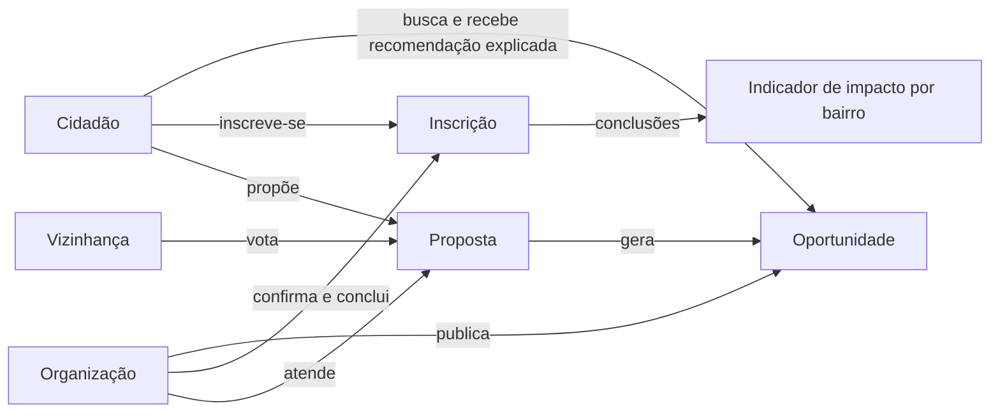

**Stack:** C# 14 · .NET 10 · ASP.NET Core Web API · Entity Framework Core 10 · MySQL 8 (`MySql.EntityFrameworkCore`) · Swagger (Swashbuckle) · JWT · BCrypt · xUnit · Moq · SQLite in-memory (testes).

### Front-end web (`front/`)

Complemento simples em **React + TypeScript + Vite** que consome esta API: início, oportunidades, painel de impacto e layout responsivo. O foco desta entrega é o backend.

<table>
  <tr>
    <td width="50%">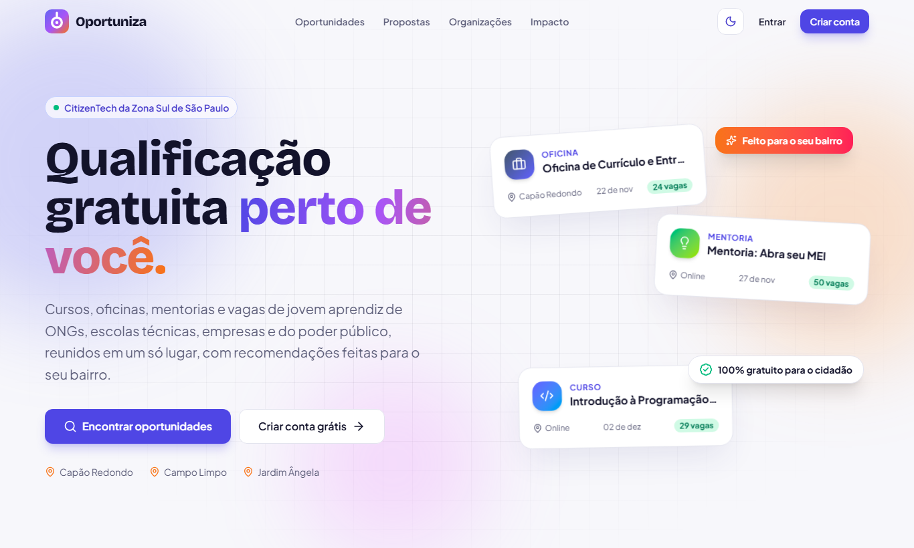<br><sub><b>Início:</b> busca, recomendações e indicadores ao vivo</sub></td>
    <td width="50%">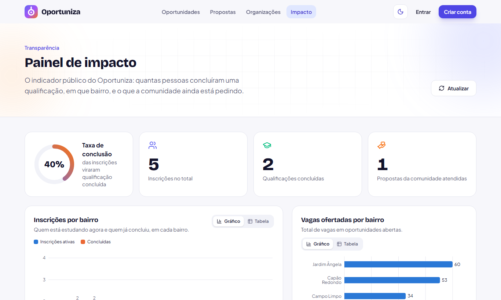<br><sub><b>Painel de impacto:</b> conclusões por bairro e demanda reprimida</sub></td>
  </tr>
  <tr>
    <td width="50%">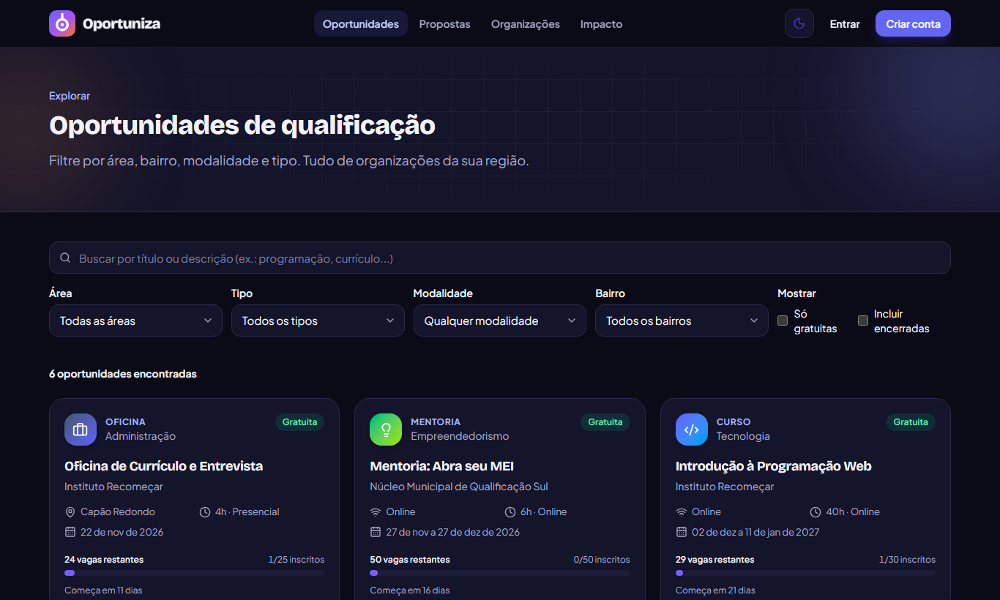<br><sub><b>Oportunidades</b> com filtros, em modo escuro</sub></td>
    <td width="50%" align="center"><br><sub><b>Responsivo:</b> a mesma tela no celular</sub></td>
  </tr>
</table>

Para rodar: `cd front && npm install && npm run dev` e abra <http://localhost:5173> (com a API no ar; se ela estiver no Docker, use `VITE_API_URL=http://127.0.0.1:5080`). Mais detalhes em [`front/README.md`](front/README.md).

## 2. Arquitetura (Clean Architecture + DDD)

```
Oportuniza.slnx
├── src/
│   ├── Oportuniza.Domain/           ← núcleo: não depende de nada
│   │   ├── Common/                  Entidade, IRaizDeAgregado, Guard
│   │   ├── ValueObjects/            Email, Endereco, Periodo
│   │   ├── Usuarios/                Usuario (abstrata) → Cidadao, Organizacao, Administrador
│   │   ├── Oportunidades/           Oportunidade (raiz; fábrica de inscrições)
│   │   ├── Inscricoes/              Inscricao (raiz; máquina de estados)
│   │   ├── Propostas/               Proposta (raiz) + Voto (entidade interna do agregado)
│   │   ├── Recomendacoes/           MotorDeRecomendacao (serviço de domínio) + critérios (Strategy)
│   │   └── Exceptions/              hierarquia DomainException
│   ├── Oportuniza.Application/      ← casos de uso; depende só do Domain
│   │   ├── Services/                um serviço por caso de uso, todos atrás de interface
│   │   ├── Ports/Persistence/       IRepositorio<T> (só raízes de agregado), IUnitOfWork
│   │   ├── Ports/Queries/           IIndicadorQueries (lado de leitura, CQRS simplificado)
│   │   ├── Ports/Services/          IConsultaCepGateway, ITokenService, IPasswordHasher
│   │   ├── Inscricoes/Regras/       IRegraInscricao (regras que consultam o banco)
│   │   └── Dtos/                    records de entrada (com validação) e saída
│   ├── Oportuniza.Infrastructure/   ← adaptadores: implementa as portas
│   │   ├── Persistence/             DbContext, Fluent API, migrações, RepositorioBase<T>, repositórios, queries
│   │   ├── External/ViaCep/         cliente HTTP do ViaCEP
│   │   ├── Security/                JWT e BCrypt
│   │   └── HealthChecks/            verificação do banco
│   └── Oportuniza.Api/              ← entrada HTTP e composition root
│       ├── Controllers/             um controller por recurso
│       └── Infrastructure/          erros, segurança, rate limiting, JWT, Swagger
└── tests/Oportuniza.Tests/          Domain · Application · Infrastructure · Api · Integration
```

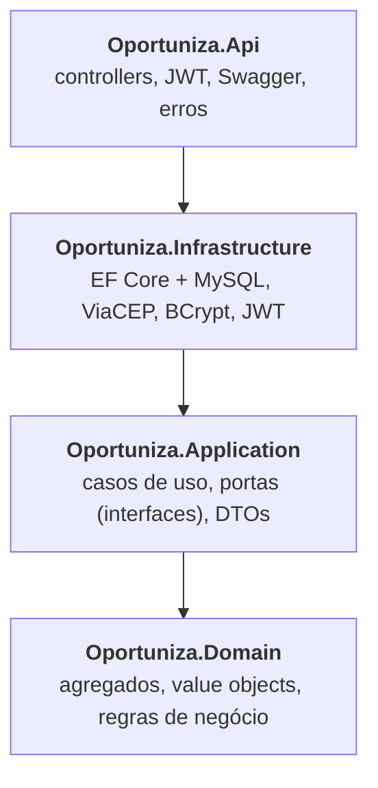

**Regra de dependência:** `Api → Infrastructure → Application → Domain`. O domínio não conhece EF Core nem ASP.NET; a Application só conhece interfaces (portas); a Api só usa a Infrastructure no `Program.cs` (composition root).

### DDD aplicado
- **Agregados e raízes:** `Usuario`, `Oportunidade`, `Inscricao` e `Proposta` implementam `IRaizDeAgregado`. O repositório genérico `IRepositorio<T> where T : IRaizDeAgregado` impede, em tempo de compilação, criar repositório para entidades internas como o `Voto`, que só entra por `Proposta.RegistrarVoto()`.
- **Value objects imutáveis e sempre válidos:** `Email` (normalizado, igualdade por valor), `Endereco` (CEP e UF validados), `Periodo` (o término nunca vem antes do início).
- **Invariantes no agregado:** `Oportunidade.Inscrever()` é a única forma de criar uma `Inscricao` (o construtor é `internal`) e garante RN-I1, RN-I2, RN-I4 e RN-I5 em um só lugar.
- **Serviço de domínio:** `MotorDeRecomendacao`, que não acessa banco e recebe as candidatas prontas.
- **Linguagem ubíqua em português:** cidadão, oportunidade, inscrição, proposta, voto, vaga, bairro.

### SOLID aplicado
| Princípio | Onde |
|---|---|
| **S** (responsabilidade única) | Um serviço por caso de uso; controllers só traduzem HTTP; `FabricaDeOportunidades` concentra a criação; leitura (`IndicadorQueries`) separada da escrita (repositórios) |
| **O** (aberto/fechado) | Critérios de recomendação (`ICriterioRecomendacao`) e regras de inscrição (`IRegraInscricao`): uma regra ou critério novo é uma classe nova registrada no DI, sem alterar o motor nem o serviço. O teste `CriterioNovo_EntraSemMudarOMotor` prova isso |
| **L** (substituição de Liskov) | `Cidadao`, `Organizacao` e `Administrador` substituem `Usuario` (login, JWT e bloqueio funcionam igual para os três) |
| **I** (segregação de interfaces) | Portas pequenas e específicas: `IPasswordHasher`, `ITokenService`, `IConsultaCepGateway`, `IIndicadorQueries`, um repositório por agregado |
| **D** (inversão de dependência) | A Application depende de abstrações; a Infrastructure as implementa; o `TimeProvider` é injetado (nenhum `DateTime.Now` nos casos de uso) |

### Modelo de domínio

```
Usuario (abstrata, TPH) ──┬── Cidadao       (escolaridade, áreas de interesse, endereço)
  Perfil (abstrato)       ├── Organizacao   (tipo, descrição, site)
  Email (VO)              └── Administrador
  bloqueio de login

Organizacao 1 ── * Oportunidade 1 ── * Inscricao * ── 1 Cidadao
                   Periodo (VO)
Cidadao 1 ── * Proposta 1 ── * Voto * ── 1 Cidadao
Proposta 0..1 ── 0..1 Oportunidade (gerada ao atender a proposta)
```

**Ciclo de vida da inscrição** (máquina de estados em `Inscricao`; transição inválida lança `ValidacaoException`):

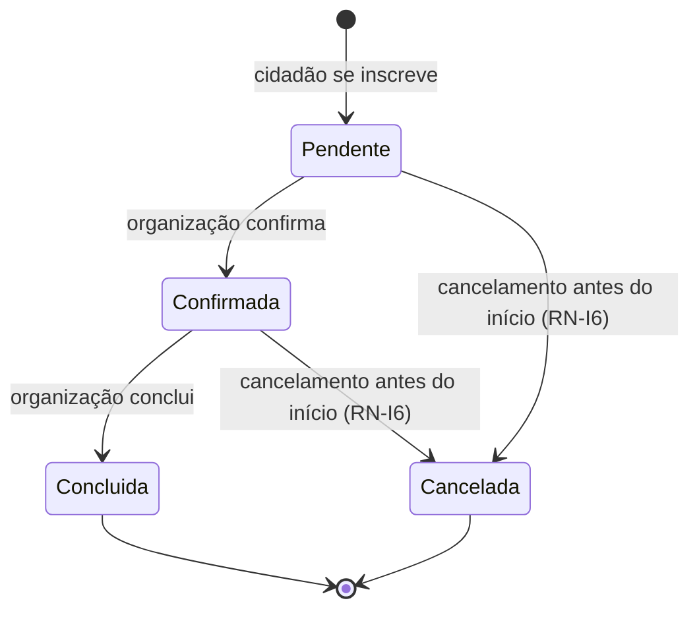

O indicador de impacto conta as inscrições **Concluídas** como qualificação concluída; as **Pendentes** e **Confirmadas** (ativas) ocupam vaga, e o cancelamento devolve a vaga.

## 3. Pré-requisitos

- **.NET SDK 10**
- **MySQL 8** em `localhost:3306`

**Configuração e segredos.** Nenhum arquivo versionado contém senha ou segredo: o `appsettings.json` e o `appsettings.Development.json` não têm connection string nem chave JWT. Em desenvolvimento, guarde-os no **user-secrets** do .NET (ficam fora do repositório, no perfil do seu usuário):

```bash
cd src/Oportuniza.Api
dotnet user-secrets set "ConnectionStrings:Default" "Server=localhost;Port=3306;Database=oportuniza;User=root;Password=SUA_SENHA;"
dotnet user-secrets set "Jwt:Secret" "um-segredo-aleatorio-com-pelo-menos-32-caracteres"
```

Em outros ambientes (ou sem user-secrets), use variáveis de ambiente:

```bash
# PowerShell
$env:ConnectionStrings__Default = "Server=localhost;Port=3306;Database=oportuniza;User=root;Password=SUA_SENHA;"
$env:Jwt__Secret = "um-segredo-aleatorio-com-pelo-menos-32-caracteres"
```

A API **não sobe** sem a connection string ou com um segredo JWT menor que 32 caracteres (validação na inicialização).

## 4. Como rodar

```bash
dotnet tool restore                        # dotnet-ef e reportgenerator (manifesto dotnet-tools.json)
dotnet run --project src/Oportuniza.Api    # http://localhost:5080 → abre o Swagger
```

No perfil de desenvolvimento, a API aplica as migrações sozinha ao iniciar e cria o banco `oportuniza`. Para aplicar as migrações manualmente:

```bash
$env:ConnectionStrings__Default = "Server=localhost;Port=3306;Database=oportuniza;User=root;Password=SUA_SENHA;"   # PowerShell; no bash: export ConnectionStrings__Default=...
dotnet dotnet-ef database update --project src/Oportuniza.Infrastructure --startup-project src/Oportuniza.Api
```

### Alternativa: Docker (API + MySQL em contêineres Linux)

Não precisa ter .NET nem MySQL instalados, só o Docker Desktop. As senhas ficam num arquivo `.env` (fora do Git): copie o modelo e troque os valores antes de subir.

```bash
cp .env.example .env           # PowerShell/cmd: copy .env.example .env
# edite .env: MYSQL_ROOT_PASSWORD e JWT_SECRET (mínimo 32 caracteres)
docker compose up -d --build   # API em http://localhost:5080/swagger + MySQL 8.4 (porta 3307 no host)
docker compose logs -f api     # acompanha a inicialização (migrações + seed)
docker compose down            # para tudo; "down -v" também apaga o banco
```

Com a API no Docker, chame-a por `http://127.0.0.1:5080` (em vez de `localhost`), por exemplo no `VITE_API_URL` do front
e nos testes E2E (`VITE_API_URL=http://127.0.0.1:5080 npm run e2e` em `front/`). O front continua sendo aberto em `http://localhost:5173`, a única origem liberada no CORS.

O `Dockerfile` é multi-stage: compila com a imagem `dotnet/sdk:10.0` e roda na `dotnet/aspnet:10.0`, com usuário sem privilégios (`app`). O `docker-compose.yml` espera o MySQL ficar saudável (healthcheck) antes de subir a API e limita a memória de cada contêiner.

### Migrações (EF Core)

| # | Migração | O que faz |
|---|---|---|
| 1 | `InicialUsuarios` | Tabela `usuarios` (TPH: admin, cidadão, organização) e índice único em `email` |
| 2 | `AdicionaOportunidades` | Tabela `oportunidades` (FK para a organização), índices por status/área e bairro |
| 3 | `AdicionaInscricoes` | Tabela `inscricoes` (FKs para o cidadão e a oportunidade) |
| 4 | `AdicionaPropostasEVotos` | Tabelas `propostas` e `votos`, com índice único (proposta, cidadão) |
| 5 | `SeedDadosFicticios` | Dados **fictícios** de demonstração (sem dados pessoais reais) |
| 6 | `AdicionaControleDeLogin` | Colunas de proteção contra força bruta (`tentativas_login_falhas`, `bloqueado_ate`, `ultimo_login_em`) |

## 5. Usuários de demonstração (seed)

Todos usam a senha **`Senha@123`**.

| Perfil | E-mail |
|---|---|
| Admin | `admin@oportuniza.local` |
| Organização (ONG) | `contato@recomecar.local` |
| Organização (escola técnica) | `secretaria@etzonasul.local` |
| Organização (poder público) | `nucleo.sul@qualifica.local` |
| Cidadã (Capão Redondo) | `ana@exemplo.local` |
| Cidadão (Campo Limpo) | `bruno@exemplo.local` |
| Cidadã (Jardim Ângela) | `carla@exemplo.local` |

**No Swagger:** `POST /auth/login` → copie o `token` → **Authorize** → cole o token (sem `Bearer`).

## 6. Documentação dos endpoints

- **Swagger UI:** <http://127.0.0.1:5080/swagger> (ou `http://localhost:5080/swagger`, conforme o ambiente), gerado dos controllers e dos comentários XML
- **OpenAPI JSON:** `/swagger/v1/swagger.json` · cópia offline em [`docs/openapi.json`](docs/openapi.json)
- **Roteiro de demonstração:** [`docs/requests.http`](docs/requests.http)

| Método | Rota | Acesso | Descrição |
|---|---|---|---|
| POST | `/auth/login` | público (rate limit) | Login, devolve o JWT |
| POST | `/cidadaos` | público | Cadastro de cidadão (201 + Location) |
| GET | `/cidadaos` | Admin | Lista paginada (`?bairro=`), sem e-mail (minimização de dados) |
| GET/PUT/DELETE | `/cidadaos/{id}` | próprio ou Admin | Detalhar / atualizar / desativar (exclusão lógica) |
| GET | `/cidadaos/{id}/inscricoes` | próprio ou Admin | Inscrições (`?status=`) |
| GET | `/cidadaos/{id}/recomendacoes` | próprio ou Admin | Recomendações com pontuação e motivos |
| POST | `/organizacoes` | público | Cadastro de organização |
| GET | `/organizacoes`, `/organizacoes/{id}` | público | Listar (`?tipo=`) / detalhar |
| PUT/DELETE | `/organizacoes/{id}` | própria ou Admin | Atualizar / desativar |
| GET | `/oportunidades` | público | Busca: `area`, `bairro`, `modalidade`, `tipo`, `gratuita`, `organizacaoId`, `texto`, `somenteComVagas`, `pagina`, `tamanho` (máx. 50) |
| GET | `/oportunidades/{id}` | público | Detalhar |
| POST | `/oportunidades` | Organização | Publicar |
| PUT | `/oportunidades/{id}` | dona ou Admin | Atualizar |
| PATCH | `/oportunidades/{id}/encerrar`, `/cancelar` | dona ou Admin | Encerrar inscrições / cancelar |
| POST | `/oportunidades/{id}/inscricoes` | Cidadão | Inscrever-se (RN-I1 a RN-I7) |
| GET | `/oportunidades/{id}/inscricoes` | dona ou Admin | Lista de inscritos |
| GET | `/inscricoes/{id}` | cidadão, org. dona ou Admin | Detalhar |
| PATCH | `/inscricoes/{id}/confirmar`, `/concluir` | org. dona ou Admin | Avançar o status |
| PATCH | `/inscricoes/{id}/cancelar` | cidadão, org. dona ou Admin | Cancelar (RN-I6) |
| GET | `/propostas`, `/propostas/{id}` | público | Ranking por votos (`bairro`, `area`, `status`, `ordenarPorVotos`) |
| POST | `/propostas` | Cidadão | Criar proposta |
| POST | `/propostas/{id}/votos` | Cidadão | Votar (RN-P1, RN-P2) |
| POST | `/propostas/{id}/atender` | Organização | Atender: cria a oportunidade vinculada (RN-P3) |
| PATCH | `/propostas/{id}/arquivar` | autor ou Admin | Arquivar |
| GET | `/indicadores/impacto` | público | Indicador de impacto |
| GET | `/enderecos/{cep}` | público | Consulta ao ViaCEP |
| GET | `/health` | público | Status da API e do banco (monitoramento) |

**Erros:** `{"mensagem": "..."}` com 400, 401, 403, 404, 409 (conflito/concorrência), 429 (bloqueio/rate limit) e 503 (ViaCEP fora do ar). Erros de validação: `[{"campo": "...", "mensagem": "..."}]`. Enums trafegam só como texto (`"Tecnologia"`); números são recusados.

## 7. Regras de negócio

| ID | Regra | Onde |
|---|---|---|
| RN-I1 | Só se inscreve em oportunidade **aberta** | `Oportunidade.Inscrever()` |
| RN-I2 | Precisa haver **vaga** | `Oportunidade.Inscrever()` + token de concorrência em `vagas_ocupadas` |
| RN-I3 | Sem inscrição **ativa duplicada** | `RegraInscricaoUnica` |
| RN-I4 | Cidadão **inativo** não se inscreve | `Oportunidade.Inscrever()` |
| RN-I5 | Inscrição só **até a data de início** | `Oportunidade.Inscrever()` |
| RN-I6 | Cancelamento só **antes do início**, e a vaga volta | `Inscricao.Cancelar()` |
| RN-I7 | No máximo **3 inscrições ativas** por cidadão (distribui as vagas gratuitas) | `RegraLimiteInscricoesAtivas` |
| RN-O1 | Só a **organização dona** (ou admin) altera a oportunidade e as inscrições dela | `OportunidadeService` / `InscricaoService` |
| RN-P1 | **Um voto** por cidadão por proposta | `Proposta.RegistrarVoto()` + índice único em `votos` |
| RN-P2 | Só propostas **abertas** recebem voto | `Proposta.RegistrarVoto()` |
| RN-P3 | Só **organizações** atendem propostas | `PropostaService.AtenderAsync()` |

**Recomendação** (`MotorDeRecomendacao`): interesse declarado **+3**, mesmo bairro **+2**, online **+1**, gratuita **+1**. Oportunidades lotadas, fora do prazo ou em que o cidadão já está inscrito são excluídas; cada recomendação vem com os **motivos**.

## 8. Segurança

| Ameaça (OWASP API Top 10) | Proteção | Onde |
|---|---|---|
| **Força bruta no login** | Conta bloqueada por 15 min após 5 senhas erradas seguidas (429); rate limit de 10 logins/min por IP | `Usuario.RegistrarFalhaDeLogin()`, `RateLimitingConfiguration` |
| **Enumeração de usuários** | Mesma resposta para e-mail inexistente e senha errada, e **tempo constante** (o hash é verificado mesmo sem usuário) | `AutenticacaoService`, `BCryptPasswordHasher` |
| **Senhas** | BCrypt com salt (custo 11); política mínima: 8 a 64 caracteres, letras e números | `BCryptPasswordHasher`, `SenhaForteAttribute` |
| **Token forjado ou adulterado** | JWT só HS256 (bloqueia `alg: none`), emissor/audiência/expiração obrigatórios, segredo ≥ 32 caracteres validado na subida, `jti` único | `AutenticacaoConfiguration`, `JwtTokenService` |
| **BOLA / IDOR** (acessar dados de outro) | Cada caso de uso verifica dono ou admin | `UsuarioAutenticado`, serviços |
| **BFLA** (função de outro perfil) | `[Authorize(Roles=...)]` + checagem de perfil no caso de uso | controllers e serviços |
| **Mass assignment** | DTOs `record` explícitos; `id`, `perfil`, `ativo` etc. enviados pelo cliente são ignorados | `Dtos/` |
| **SQL injection** | Só LINQ/EF Core parametrizado; nenhuma SQL concatenada | repositórios (testado com payloads reais) |
| **XSS armazenado** | JSON com `< > & ' "` escapados, `nosniff`, CSP `default-src 'none'`; site de organização só `http(s)` (bloqueia `javascript:`) | `Program.cs`, `SecurityHeadersMiddleware`, `Organizacao` |
| **Vazamento de detalhes internos** | Erros 500 com mensagem neutra; mensagens do desserializador (com nomes de tipos .NET) substituídas | `GlobalExceptionHandler`, `ValidacaoResponse` |
| **Clickjacking, cache e referer** | `X-Frame-Options: DENY`, `frame-ancestors 'none'`, `Cache-Control: no-store`, `Referrer-Policy: no-referrer`, sem cabeçalho `Server` | `SecurityHeadersMiddleware` |
| **Transporte** | HTTPS obrigatório e HSTS de 1 ano fora do ambiente de desenvolvimento (`Seguranca:ForcarHttps`) | `Program.cs` |
| **Abuso de recursos** | Rate limit global (300 req/min por IP), corpo de até 1 MB, página de no máximo 50 itens, limites de tamanho em todos os campos | `Program.cs`, `Paginacao`, DTOs |
| **CORS** | Só as origens listadas em `Cors:OrigensPermitidas` | `Program.cs` |
| **Corrida pela última vaga** | Token de concorrência otimista em `vagas_ocupadas` (409) | `OportunidadeConfiguration` |
| **Segredos no código** | Nenhuma senha no `appsettings.json`; produção via variáveis de ambiente | seção 3 |
| **Dados pessoais (LGPD)** | Seed só com dados fictícios; listagem do admin sem e-mail ou data de nascimento; exclusão lógica | migração 5, `DadosListagemCidadao` |
| **Dependências vulneráveis** | `dotnet list package --vulnerable --include-transitive`: nenhuma encontrada | — |
| **Análise estática** | Analisadores .NET em modo `Recommended` (inclui as regras de segurança CA2100, CA53xx): **zero avisos** | `Directory.Build.props` |

## 9. Testes

```bash
dotnet test                                    # 338 testes, sem MySQL e sem internet
dotnet test --settings coverage.runsettings    # com cobertura (Cobertura XML)
dotnet reportgenerator -reports:"**/TestResults/*/*.cobertura.xml" -targetdir:cobertura -reporttypes:Html
```

**Cobertura: 100% das linhas e 98,6% dos branches** no relatório Cobertura gerado pelo `dotnet test --settings coverage.runsettings` (saída salva em [`evidencias/10-dotnet-test.txt`](evidencias/10-dotnet-test.txt); migrações e código gerado pelo compilador ficam fora da medição).

| Pasta | O que cobre |
|---|---|
| `Domain/` | Value objects, invariantes de cada agregado, máquina de estados da inscrição, bloqueio de login, polimorfismo, motor e critérios de recomendação |
| `Application/` | Paginação, política de senha, regras RN-I3/RN-I7, **todos os casos de uso** (caminho feliz, regra violada, 403 e 404), mapeamento de DTOs e registro de DI |
| `Infrastructure/` | Repositórios e consultas LINQ em **SQLite real** (cada filtro, ordenação, paginação, índices únicos, token de concorrência, SQL injection), as 6 migrações + seed aplicadas, ViaCEP (sucesso, 404, 5xx, timeout, JSON quebrado), JWT, BCrypt, health check e configuração |
| `Api/` | Mapeamento de cada exceção para status HTTP, claims do token, sanitização das mensagens de validação, chave do rate limit |
| `Integration/` | A API inteira por HTTP (`WebApplicationFactory`): cada endpoint, fluxo completo até o indicador e os **ataques**: token forjado, expirado, adulterado e `alg: none`; força bruta; enumeração de usuários; BOLA/BFLA; mass assignment; SQL injection; XSS; CORS; cabeçalhos; rate limit; HTTPS/HSTS em produção |

## 10. Mapeamento dos critérios de avaliação

### SOA e Web Services

| Critério (peso) | Onde está |
|---|---|
| **Estruturação do domínio (3,0)** | `src/Oportuniza.Domain` organizado por agregados (DDD), value objects, serviço de domínio, exceções; camadas da arquitetura limpa (seção 2) |
| **Conexão com banco de dados (3,0)** | MySQL via EF Core: `OportunizaDbContext`, Fluent API em `Persistence/Configurations`, repositórios, connection string por variável de ambiente, `GET /health` testa a conexão |
| **Migrações (1,5)** | 6 migrações incrementais em `Infrastructure/Persistence/Migrations` (seção 4), com seed; validadas de ponta a ponta nos testes |
| **Documentação automática (1,5)** | Swagger/OpenAPI dos controllers e comentários XML (`SwaggerConfiguration.cs`), esquema Bearer, **exemplos de request/response** em 14 DTOs, descrição de cada campo (`<param>` nos records) e de cada parâmetro, `docs/openapi.json` e teste do documento |
| **Testes automatizados (1,0)** | 338 testes xUnit, 100% das linhas cobertas (seção 9) |
| Chamadas a APIs REST | API REST própria + consumo do **ViaCEP** (`ViaCepClient.cs`) |

### C# Software Development

| Critério (peso) | Onde está |
|---|---|
| **POO (3,0)** | Herança `Usuario` → `Cidadao`/`Organizacao`/`Administrador`; `Perfil` abstrato (polimorfismo); encapsulamento total (setters privados, coleções somente leitura, construtores `internal`); value objects; interfaces e Strategy (seção 2) |
| **Web API (2,5)** | Controllers REST em `src/Oportuniza.Api/Controllers`, verbos e status corretos (201 + Location, 204, 400, 401, 403, 404, 409, 429, 503), DTOs `record` validados, JWT por perfil, erros padronizados, CORS, rate limiting |
| **EF Core + LINQ (1,5)** | TPH, owned types (`Endereco`, `Periodo`), value converters (`Email`, lista de áreas), token de concorrência; LINQ com filtros dinâmicos e paginação, `GroupBy` com agregações condicionais (`IndicadorQueries`), ranking (`MotorDeRecomendacao`) |
| **Async/Await (1,0)** | Toda a cadeia é assíncrona (controller → serviço → repositório → EF Core/HttpClient) com `CancellationToken` propagado |
| **Qualidade do código (2,0)** | Arquitetura limpa, DDD, SOLID, injeção de dependência, `TimeProvider`, *nullable* habilitado, analisadores .NET sem avisos, 100% das linhas cobertas |
| Interfaces + Injeção de Dependência | `Application/DependencyInjection.cs`, `Infrastructure/DependencyInjection.cs` |
| Testes unitários | `tests/Oportuniza.Tests` |

## 11. Evidências

Os principais prints estão abaixo. **Para consultar as demais evidências** (um print de cada endpoint do Swagger e as saídas de execução em texto), acesse a pasta [`evidencias/`](evidencias/).

### Documentação automática (Swagger / OpenAPI)

A API publica o Swagger UI em `/swagger`, gerado a partir dos controllers, dos comentários XML e dos DTOs. Cada endpoint traz o resumo, os parâmetros, os códigos de resposta possíveis (200, 201, 400, 401, 403, 404, 409, 429...) e exemplos de requisição e de resposta.

**Visão geral:** os 36 endpoints organizados em 8 grupos (Autenticação, Cidadãos, Endereços, Indicadores, Inscrições, Oportunidades, Organizações e Propostas), mais o botão **Authorize** para o token JWT.

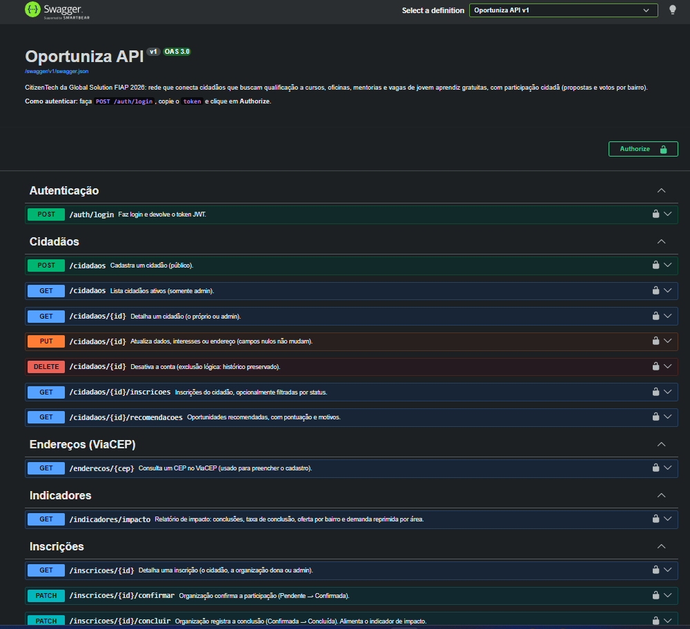
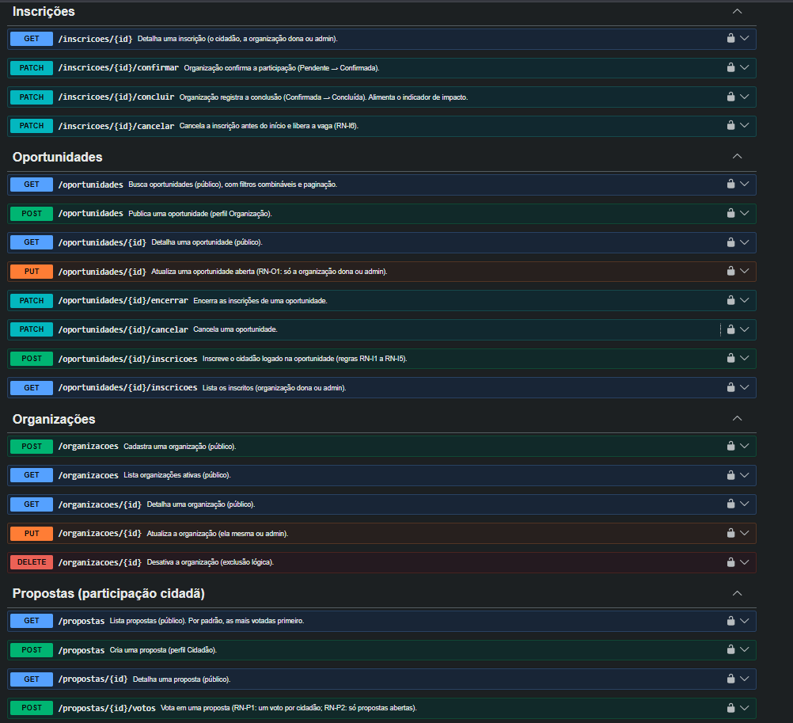

**Autenticação:** `POST /auth/login` devolve o token JWT. A documentação descreve o limite de requisições por IP e o bloqueio da conta por 15 minutos após 5 senhas erradas seguidas (429).

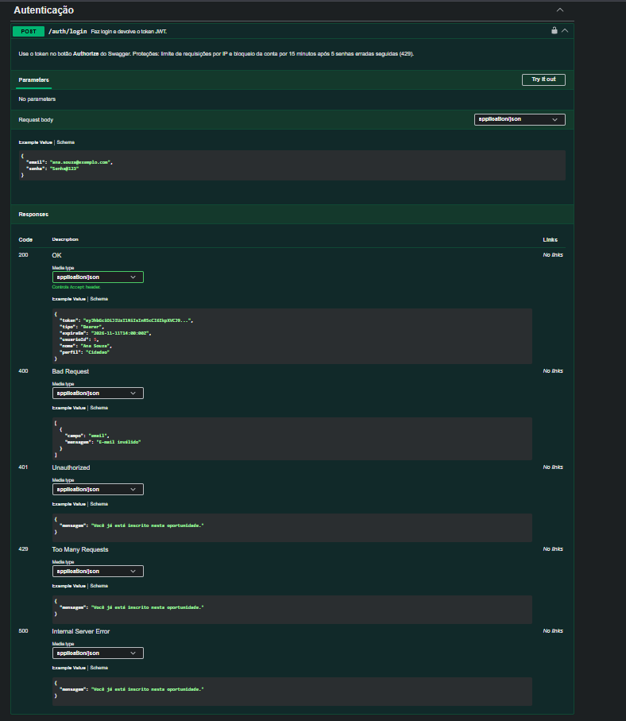

**Cadastro com validação:** `POST /cidadaos` é público; os exemplos mostram o corpo esperado, o 201 de sucesso e o 400 de validação.

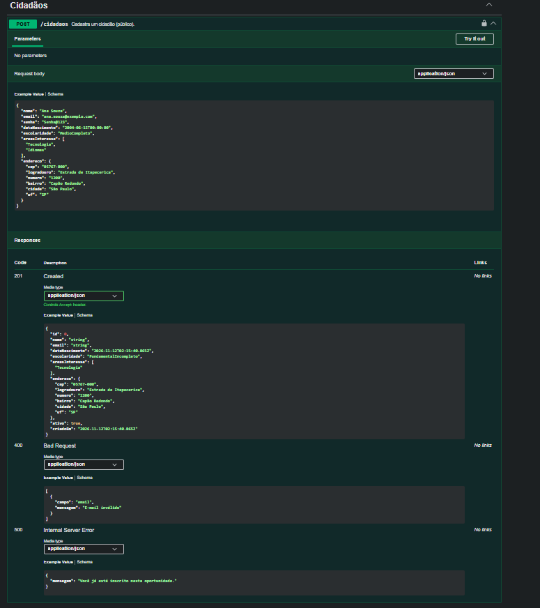

**Recomendação explicada:** `GET /cidadaos/{id}/recomendacoes` devolve as oportunidades com a pontuação e os motivos (interesse, mesmo bairro, modalidade online, gratuidade). Sem caixa-preta.

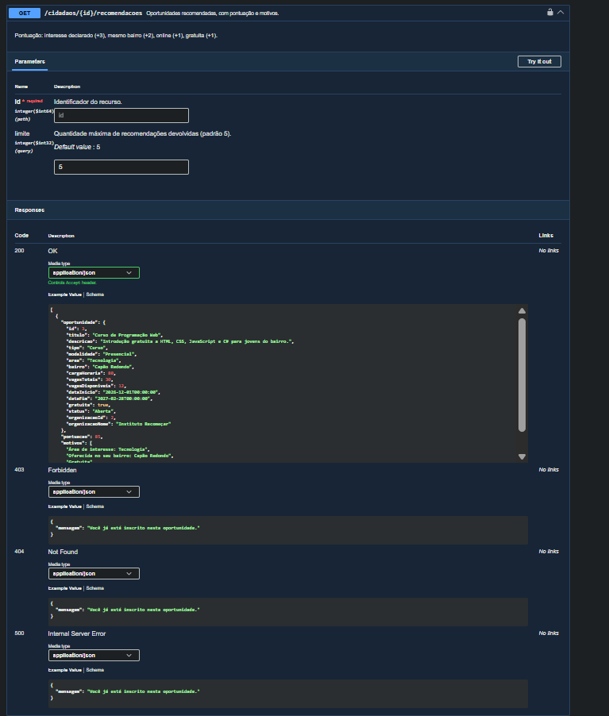

**Regras de negócio na inscrição:** `POST /oportunidades/{id}/inscricoes` aplica as regras RN-I1 a RN-I5 (vagas, inscrição duplicada, oportunidade aberta etc.).

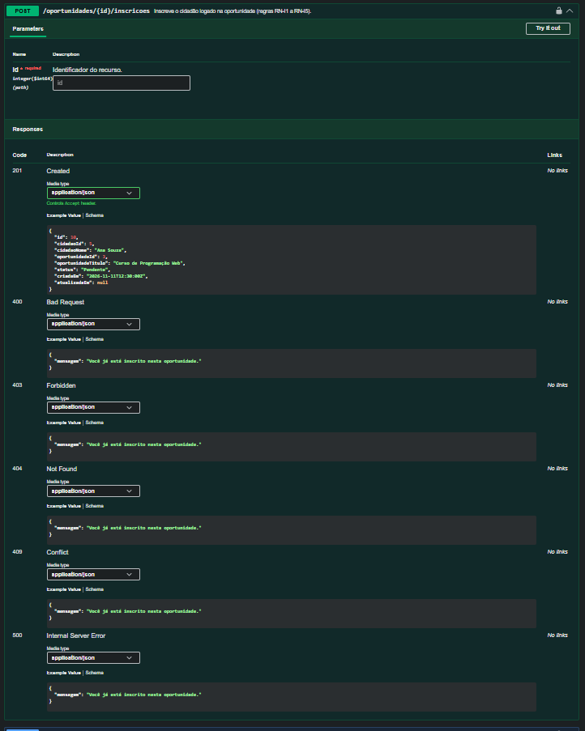

**Participação cidadã:** `POST /propostas/{id}/votos` garante um voto por cidadão (RN-P1) e só em propostas abertas (RN-P2). A listagem de propostas tem filtros e paginação.

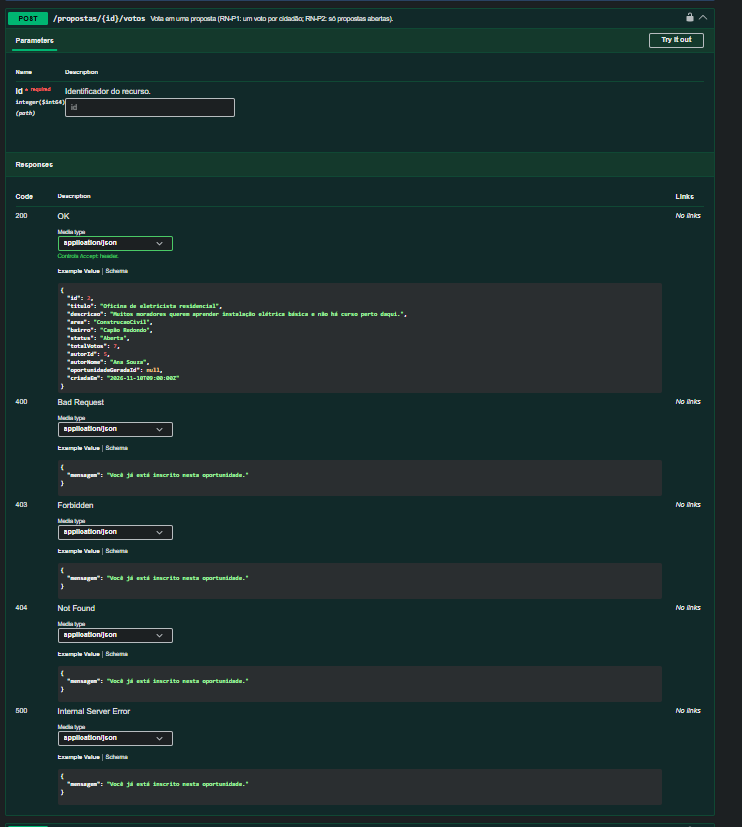
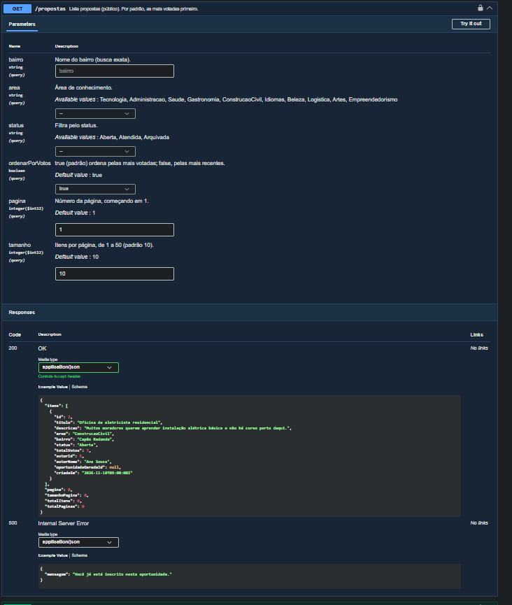

**Indicador de impacto:** `GET /indicadores/impacto` entrega a taxa de conclusão, a oferta por bairro e a demanda reprimida por área.

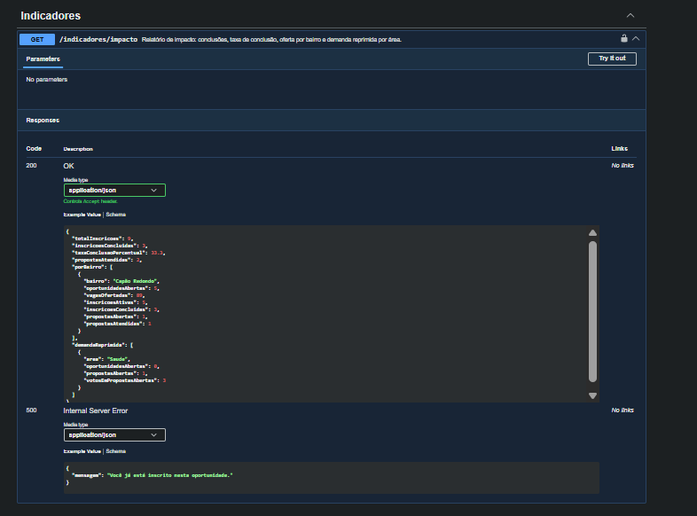

### Front-end

As capturas do front-end (28 imagens: 7 telas em tema claro e escuro, desktop e celular, feitas com Playwright) ficam em [`evidencias/front/`](evidencias/front/).
